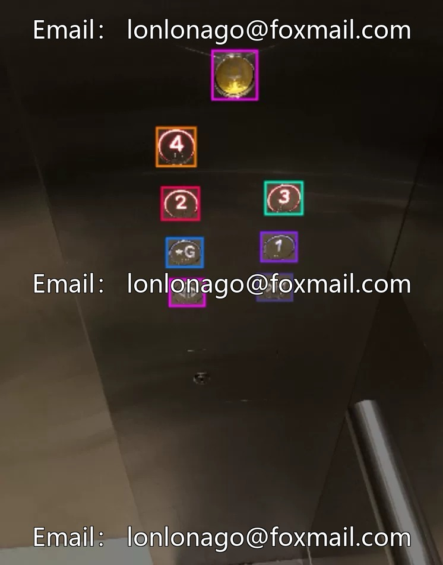
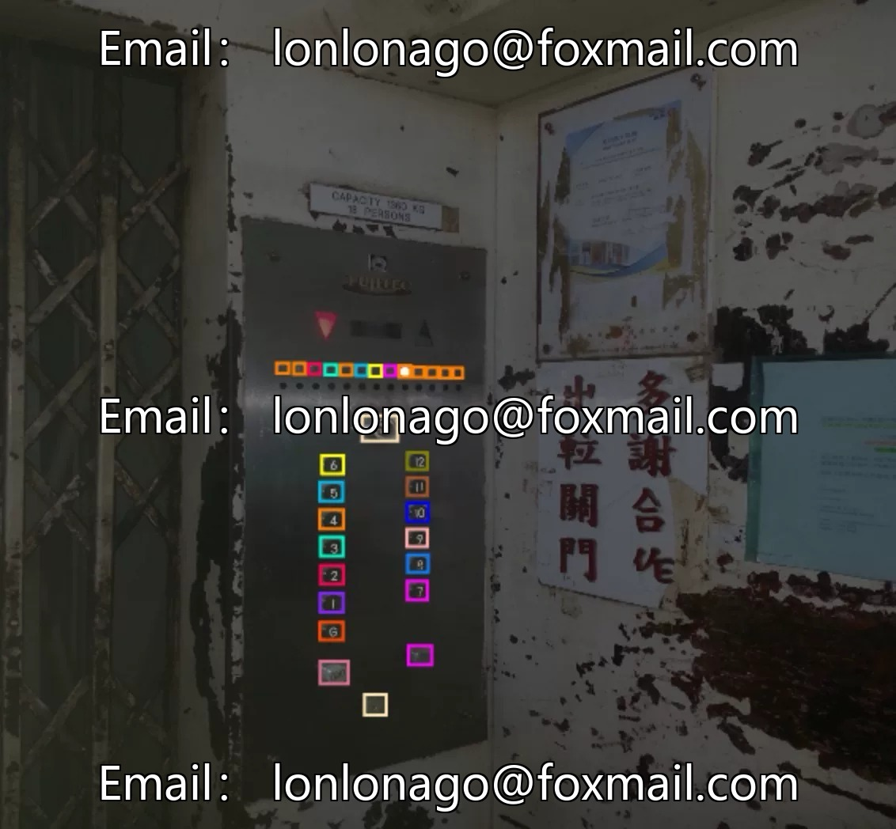
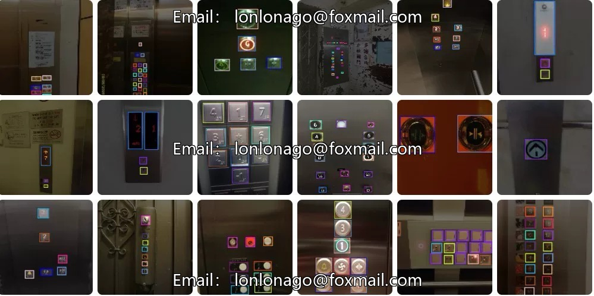
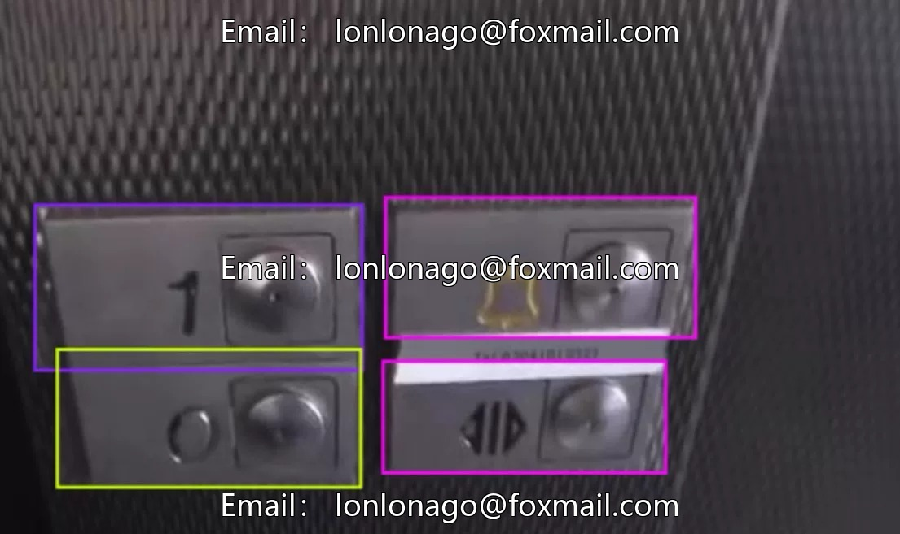
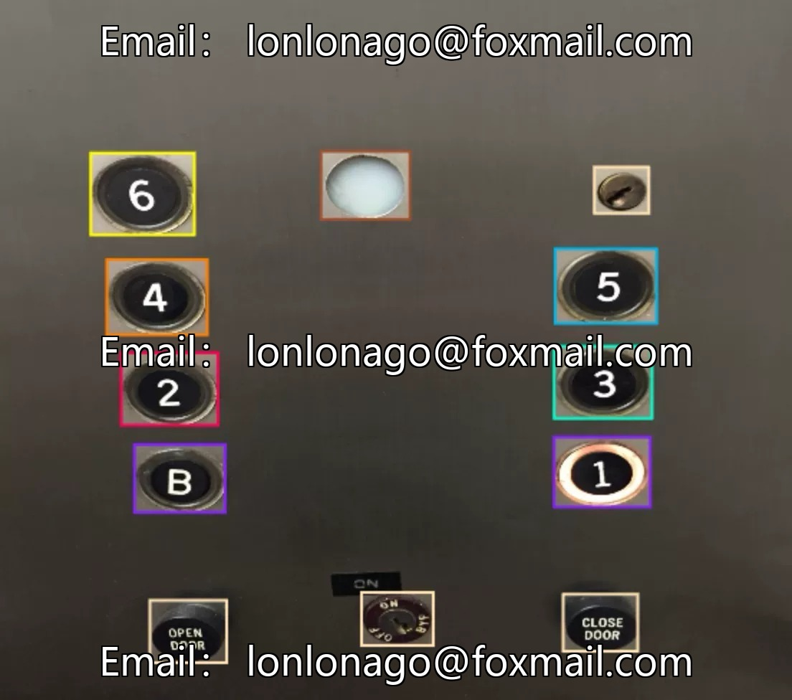

# Elevator button recognition dataset

## Body

Elevator button recognition dataset for intelligent AI to target detection of elevator buttons, 2019 images, 205 sub-categories, covering common elevator buttons such as numbers, letters, special signs, etc., supports model training and testing.

The data format is an image file with annotations, suitable for the development of computer vision models such as YOLO and object detection. It can be applied in scenarios like elevator automatic call-waiting, assistance for people with disabilities, and elevator fault diagnosis.

Virtual materials, once sold, are non-refundable.
Interested friends, click "I want" to proceed.

## Images

## Payment

Here is a pay link on Stripe ( https://buy.stripe.com/3cs8yP7sY87d0vu9AB ). Please contact me lonlonago@foxmail.com after funding $89, and I will send you a complete data files , thank you!

